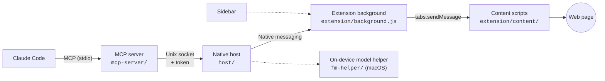

<p align="center">
  
</p>

<h1 align="center">Tabwright</h1>

<p align="center">
  <b>Tabwright</b> lets Claude Code read and operate the Firefox tabs <em>you</em> allow, in your normal logged-in profile,<br>
  with your click required for anything that submits, sends, pays or deletes.
</p>

<p align="center">
  <a href="LICENSE"></a>
  
  
  
</p>

> **Not affiliated with Anthropic or Mozilla.** This is an independent community project. "Claude" and "Claude Code" are trademarks of Anthropic, PBC, and "Firefox" is a trademark of the Mozilla Foundation. They're used here only to say what this works with.

---

## Contents

- [What it does](#what-it-does)
- [How it works](#how-it-works)
- [Install](#install)
- [Use](#use)
- [Tool reference](#tool-reference)
- [Instruction mode (sidebar)](#instruction-mode-sidebar)
- [Configuration](#configuration)
- [Safety model](#safety-model)
- [Privacy](#privacy)
- [Troubleshooting](#troubleshooting)
- [Development](#development)
- [Testing](#testing)
- [Project layout](#project-layout)
- [Known limitations](#known-limitations)
- [Contributing](#contributing) · [Security](#security) · [License](#license)

## What it does

- **Works in your real Firefox.** It uses your existing window, profile, cookies and logins. Nothing runs headless and nothing is scraped from a separate browser.
- **Off by default.** Claude can only see or touch a site after you click **Allow Claude on _site_** in the toolbar popup.
- **You approve consequential actions.** Clicks that submit, send, pay, delete, sign, post or publish, Enter-to-submit, and risky URLs all pause on an Allow/Deny prompt drawn inside the page. The page can't fake or click that prompt. The extension makes this decision; the model can't skip it.
- **Visible and stoppable.** A tab being driven gets an outline and a "Claude is controlling this tab" banner. **Esc** in the tab, or **Stop** in the popup or sidebar, cancels everything and disconnects.
- **Handles modern forms.** Typing works with React and Vue controlled inputs, `react-select`-style comboboxes, radio groups, checkboxes, file inputs and drop zones, shadow DOM and same-site iframes.
- **Keeps sensitive fields off limits.** Password, one-time-code and payment card fields can't be read or typed into.
- **Can run without a terminal.** The Firefox sidebar takes a plain-language instruction and carries it out. It uses Claude when available, then Apple's on-device model, then simple rules.

The first use case was filling out job applications (Greenhouse, Lever, Ashby, Workday), but nothing in the design is specific to that.

## How it works



| Component | Role |
|---|---|
| **MCP server** (`mcp-server/`) | Started by Claude Code. Exposes the `browser_*` tools, validates arguments, reads upload files from allowed directories, and labels page content as untrusted. |
| **Native host** (`host/`) | Started by Firefox via native messaging. Relays between the socket and the extension, authenticates socket clients with a token, and runs instruction mode. |
| **Background script** (`extension/background.js`) | Owns the native port. Enforces the site allowlist and the approval gate, injects content scripts, tracks element refs across frames, and keeps the activity log. |
| **Content scripts** (`extension/content/`) | Build the page snapshot, perform actions, draw the approval prompt, and block unapproved form submissions. |
| **Shared protocol** (`shared/protocol.ts`) | Message types, validation and chunking for native messaging's 1 MB limit. It's compiled into `extension/lib/protocol.js`. |
| **fm-helper** (`fm-helper/`) | Small Swift binary wrapping Apple's Foundation Models framework, used as the offline fallback in instruction mode. |

The full design lives in [SPEC.md](SPEC.md).

## Install

**Requirements:** Firefox 140+ and Node.js 20+. The optional on-device fallback also needs Apple Silicon, macOS 26+, Apple Intelligence turned on, and the Xcode command-line tools.

**Platforms:** macOS is tested, including the on-device fallback. Linux paths are implemented but untested. Windows isn't supported yet.

### 1. Install the native host and MCP server

```sh
git clone https://github.com/dougmolineux/tabwright.git
cd tabwright
scripts/install.sh
```

The script:

1. Runs `npm install` and `npm run build`.
2. Installs the native host to `~/.local/share/tabwright/`.
3. Writes the Firefox native messaging manifest (`tabwright.json`).
4. Creates the config directory with a random token, `config.json` and `profile.json`:
   - macOS: `~/Library/Application Support/Tabwright/`
   - Linux: `$XDG_CONFIG_HOME/tabwright/`
5. Builds the Swift helper if your OS supports it.
6. Registers the MCP server with Claude Code at user scope (`claude mcp add -s user tabwright …`).

| Option | Effect |
|---|---|
| `--no-mcp` | Skip registering the MCP server with Claude Code. |
| `--skip-build` | Reuse existing build output. |

To remove it, run `scripts/uninstall.sh`. Add `--purge` to also delete your config, token, profile and logs.

### 2. Load the extension

- **Development:** run `npm run ext:run` (temporary profile), or open `about:debugging` → **This Firefox** → **Load Temporary Add-on** and pick `extension/manifest.json`.
- **Daily use:** release Firefox only installs signed add-ons. Get API keys from [addons.mozilla.org](https://addons.mozilla.org/developers/addon/api/key/), set `WEB_EXT_API_KEY` and `WEB_EXT_API_SECRET`, run `npm run ext:sign` to sign it as unlisted, then install the `.xpi` from `web-ext-artifacts/`.

> If you fork this project, change the add-on ID in `extension/manifest.json` (`browser_specific_settings.gecko.id`), in `scripts/install.sh` and in `test/e2e/firefox.test.ts`. AMO won't sign the same ID for two different developers.

## Use

1. Click the toolbar button, then **Connect**.
2. On a page you want Claude to work on, click **Allow Claude on _site_**.
3. In Claude Code, ask for something like:

   > Fill out the application in my Firefox tab using my résumé in ~/Documents. Leave salary blank.

Claude usually starts with `browser_snapshot`. That returns a compact text outline of the page in which every interactive element has a ref (`e12`). Claude then acts on those refs. When it clicks something consequential, Firefox shows the Allow/Deny prompt in the page and the tool waits for you.

**To stop:** press **Esc** in the controlled tab, or click **Stop** in the popup or sidebar.

**Activity log:** popup → **View activity** shows the last 500 actions. Typed values are logged by length only.

**Auto-approve:** the popup has an opt-in toggle that skips the in-page approval prompt. It's off by default and stored per browser. Every auto-approved action is still logged. Only turn it on if you're watching.

## Tool reference

All tools accept an optional `tabId`; without it they act on the selected tab, or the active one. Element-targeting tools take either a `ref` from the latest snapshot, or a `target` of `{ "label": "Email" }` or `{ "text": "Next" }`.

| Tool | What it does |
|---|---|
| `browser_status` | Connection state, Firefox version, allowed sites and the selected tab. |
| `browser_list_tabs` | Open tabs with id, title, URL, and whether Claude is allowed on each. |
| `browser_select_tab` | Choose the default tab and bring it to the front. |
| `browser_open_tab` | Open a URL in a new tab and select it. |
| `browser_navigate` | Go to a URL, or `back` / `forward` / `reload`. Submit, confirm, checkout, pay and delete URLs need approval. |
| `browser_snapshot` | Text outline of the page with refs, current values and `[consequential]` markers. Use `root` to zoom into a section. |
| `browser_screenshot` | JPEG of the viewport, or of one element. |
| `browser_get_text` | Readable text of the page or an element (up to 50,000 characters). |
| `browser_click` | Click an element. Consequential clicks wait for approval. |
| `browser_type` | Type into a field and read the value back. Use `clear=false` to append and `perKey` for key-by-key input. |
| `browser_select` | Pick an option in a `<select>` or custom combobox by text or value, or several with `options`. |
| `browser_check` | Set a checkbox, switch or radio to checked or unchecked. |
| `browser_upload` | Upload a local file from an allowed directory into a file input or drop zone. |
| `browser_press_key` | Press a key (`Enter`, `Tab`, `Escape`, `ArrowDown`…). Enter-to-submit needs approval. |
| `browser_scroll` | Scroll an element into view, or scroll the page by direction and amount. |
| `browser_wait_for` | Wait for text to appear or disappear, or for an element to become visible (max 60 s). |
| `browser_fill_form` | Fill up to 100 fields in one call. Stops at the first error and never clicks consequential elements. |
| `browser_ask_user` | Ask you a question in the sidebar and wait for the answer (up to 10 minutes). |

Everything read from a page comes back wrapped in `<page_content untrusted="true" origin="…">`, so the model can tell page data from instructions.

### Error codes

| Code | Meaning | What to do |
|---|---|---|
| `E_NOT_CONNECTED` | The extension isn't connected, or the host isn't installed. | Click **Connect** in the popup, or run `scripts/install.sh`. |
| `E_SITE_NOT_ALLOWED` | The site isn't allowed, is always blocked, or a screenshot needs the toolbar click. | Click **Allow Claude on _site_** in the popup on that tab. |
| `E_NO_TAB` | The tab doesn't exist. | Call `browser_list_tabs`. |
| `E_STALE_REF` | The ref came from an old snapshot, or the page navigated. | Take a new snapshot. |
| `E_AMBIGUOUS` | A `target` matched several elements (candidates are listed). | Use a `ref`. |
| `E_NOT_INTERACTABLE` | The element is hidden, disabled, covered or missing. | Scroll, wait, or snapshot again. |
| `E_TIMEOUT` | A wait or call took too long. | Retry, or raise the timeout. |
| `E_APPROVAL_DENIED` | You clicked Deny, or the page changed first. | Ask the user what they want. |
| `E_APPROVAL_TIMEOUT` | Nobody answered the approval prompt in time. | Ask the user, or retry. |
| `E_STOPPED` | You pressed Esc or Stop. | Wait for the user. |
| `E_REFUSED_SENSITIVE` | Password, card, one-time-code field, or CAPTCHA. | Ask the user to do that step. |
| `E_FILE_NOT_ALLOWED` | The upload path is outside `allowedUploadDirs` or too big. | Move the file, or change the config. |
| `E_TOO_LARGE` | A message exceeded the size limit. | Use a smaller file or snapshot `root`. |
| `E_INTERNAL` | Anything else, including bad arguments. | Read the message. |

## Instruction mode (sidebar)

Open the sidebar (popup → **Open sidebar**), type an instruction and click **Run**:

> Fill out this application with my details. Leave work authorization and salary for me.

- **Engines, in order:**
  1. **Claude:** the host runs `claude -p` headless with this MCP server, scoped to a one-time run token.
  2. **On-device:** Apple Foundation Models, via `fm-helper`.
  3. **Rules:** fixed label patterns.

  The sidebar shows which engine is running and why it fell back.
- **Answers come from your profile** (`profile.json`, editable in the sidebar). A `null` value means "always ask me". EEO questions (gender, race, veteran and disability status) are never filled.
- **The approval gate still applies.** Instruction mode stops at the same Allow/Deny prompt as Claude Code does.

See [`scripts/profile.example.json`](scripts/profile.example.json) for the profile format, and [SPEC.md §10](SPEC.md) for the details.

## Configuration

`config.json` lives in the config directory (`~/Library/Application Support/Tabwright/` on macOS). Set `TABWRIGHT_DIR` to use a different directory.

| Key | Default | Meaning |
|---|---|---|
| `allowedUploadDirs` | `["~/Documents"]` | Only files under these directories can be uploaded. Symlinks are resolved first. |
| `maxUploadBytes` | `10485760` | Upload size limit (10 MB). |
| `snapshotCharLimit` | `25000` | Snapshot size cap. |
| `approvalTimeoutSec` | `120` | How long an approval prompt waits. |
| `draftFreeText` | `false` | On-device mode: draft answers to free-text questions, highlighted for review, instead of leaving them blank. |

**Logs:** the host logs to `~/Library/Logs/Tabwright/host.log` on macOS, or `$XDG_STATE_HOME/tabwright/` on Linux. The log rotates at 5 MB.

## Safety model

Read [SECURITY.md](SECURITY.md) before installing. It covers what the add-on protects against and, just as important, what it doesn't. In short:

- **Nothing is allowed by default.** `about:`, extension, `addons.mozilla.org`, `accounts.firefox.com` and `support.mozilla.org` pages are always blocked.
- **The extension decides what needs approval, not the model.** Each consequential action is approved on its own, unless you turn on the opt-in auto-approve toggle.
- **Unapproved form submissions are cancelled.** This backstop catches a `submit` that starts right after an agent action.
- **Sensitive fields are redacted and refused.** CAPTCHA frames can't be clicked.
- **The socket is authenticated.** It needs a 32-byte token and sits in a `0700` directory.
- **Prompt injection isn't solved.** The approval gate and the allowlist are the real protection.

## Privacy

Tabwright has no servers, accounts, analytics or telemetry. Page data from the sites you allow goes to the native host and Claude Code on your computer, and from Claude Code to Anthropic as part of your conversation with Claude. The activity log, profile and settings stay on your computer. See [PRIVACY.md](PRIVACY.md) for the details.

## Troubleshooting

<details>
<summary><b>The popup says "Native host exited" or tools return <code>E_NOT_CONNECTED</code></b></summary>

- Run `scripts/install.sh` again. It rewrites the native messaging manifest and the host wrapper.
- The wrapper stores an absolute path to `node`. If you switched Node versions (nvm, fnm, asdf) or removed that one, re-run the installer.
- Check `~/Library/Logs/Tabwright/host.log`.
- Check that `~/Library/Application Support/Mozilla/NativeMessagingHosts/tabwright.json` exists and that its `allowed_extensions` matches the add-on ID.
</details>

<details>
<summary><b>Claude Code doesn't list the <code>browser_*</code> tools</b></summary>

Run `claude mcp list`. If `firefox` is missing, register it:

```sh
claude mcp add -s user tabwright -- node /path/to/tabwright/mcp-server/dist/index.js
```
</details>

<details>
<summary><b><code>browser_screenshot</code> returns <code>E_SITE_NOT_ALLOWED</code> on an allowed site</b></summary>

Firefox only lets an extension capture a tab with `<all_urls>` or `activeTab`. Click the toolbar button on that tab once; the grant lasts until the tab navigates. `browser_snapshot` doesn't need this.
</details>

<details>
<summary><b>"Another Claude Code session is already connected"</b></summary>

Only one interactive session can drive Firefox at a time. Close the other session, or run `/mcp` in it to disconnect.
</details>

<details>
<summary><b>A payment or anti-bot widget ignores clicks or typing</b></summary>

Script-generated events have `isTrusted === false`, and some widgets reject them. Do that step yourself; Claude should tell you when this happens.
</details>

## Development

```sh
npm install
npm run build        # host + MCP server bundles, and extension/lib/protocol.js
npm run typecheck    # TypeScript (host, MCP server, shared)
npm test             # unit + integration
npm run test:e2e     # real Firefox via geckodriver
npm run fixtures     # serve test pages at http://127.0.0.1:8765/
npm run ext:run      # launch Firefox with the extension loaded
npm run ext:lint     # web-ext lint
npm run ext:package  # add-on and source zips for addons.mozilla.org (see docs/amo-listing.md)
```

`extension/lib/protocol.js` is generated from `shared/protocol.ts`. Edit the TypeScript and rebuild; don't edit the JavaScript.

The extension is plain JavaScript with no build step, so you can reload it from `about:debugging` after an edit. The host and MCP server are TypeScript bundled with esbuild, so re-run `npm run build` after changing them.

See [CONTRIBUTING.md](CONTRIBUTING.md) for conventions and the pull request checklist.

## Testing

The suite has three layers:

| Layer | Command | What runs |
|---|---|---|
| **Unit** | `npm run test:unit` | In-process tests with fakes. The background script runs against a fake WebExtension `browser`, content scripts and extension pages run in jsdom with real React and `react-select` forms, and the host, MCP tools, protocol, rules, config and upload checks are tested directly. |
| **Integration** | `npm run test:integration` | The built native host with a fake Firefox on its stdin/stdout, and the built MCP server driven by a real MCP client over the Unix socket. |
| **End-to-end** | `npm run test:e2e` | Real Firefox through Selenium and geckodriver, against the pages in `test/fixtures/`. Set `E2E_HEADLESS=1` to hide the window. |

`npm run coverage` prints a coverage report for the unit and integration layers.

The e2e suite runs Firefox in a throwaway profile. While it runs, it temporarily replaces the `tabwright` native messaging manifest and restores yours afterwards. It never calls the real Claude: instruction mode is tested with Claude marked unavailable, so it uses the on-device model or the rules.

## Project layout

```
extension/          Firefox add-on (Manifest V3, plain JS)
  background.js       native port, allowlist, approval gate, routing, activity log
  content/            snapshot, actions, approval prompt, main-world value setters
  popup/ sidebar/     toolbar popup, activity page, instruction-mode sidebar
  lib/protocol.js     generated from shared/protocol.ts
host/src/           native messaging host: socket server, instruction-mode runner, rules, on-device model
mcp-server/src/     MCP server: bridge client and browser_* tool definitions
shared/             protocol (used by everything) and Node helpers (config, token, uploads)
fm-helper/          Swift helper for Apple's on-device model
scripts/            build, install, uninstall, example profile
test/               unit, integration and e2e suites, and HTML fixtures
docs/               logo, addons.mozilla.org listing text
```

## Known limitations

- **Script events aren't trusted.** They have `isTrusted === false`, so some payment and anti-bot widgets ignore them.
- **`fetch`-only submissions can slip through.** The submit backstop catches `submit` events. A page that sends data with `fetch` from a click handler is only gated if the clicked button itself is classified as consequential.
- **The keyword list only covers buttons, links and menu items.** An "I agree…" checkbox can be ticked without a prompt.
- **Site matching ignores the port.** Allowing `localhost` allows every port on it.
- **Screenshots need one click from you.** See [Troubleshooting](#troubleshooting).
- **One interactive Claude Code session at a time.**
- **Not done yet:** full-page screenshots and Windows support.

<details>
<summary><b>Where the implementation differs from SPEC.md</b></summary>

- **Screenshots need `activeTab`.** A single-site grant isn't enough for Firefox to allow capture, so `browser_screenshot` needs the toolbar click described above. `browser_snapshot` doesn't.
- **Site matching ignores the port**, because Firefox match patterns can't include one.
- **The consequential-action keyword list applies to buttons, links and menu items only.** Form submission, Enter-to-submit and risky URLs are gated as specified.
- **Deny has focus in the approval prompt**, so a stray Enter denies.
- **A second, scoped socket client is allowed during a sidebar run.** This lets the headless `claude -p` session's MCP server connect while your interactive session holds the main connection.
- **On-device matching is constrained.** The model's answer is limited to your real profile keys, and a yes/no follow-up confirms each match. The host rejects skip-labels that don't appear in your instruction, and fixed patterns catch out-of-scope requests the small model misses. The model's `option` guess is ignored, since it never sees profile values; options are chosen from the profile value.
- **E2E uses Selenium and geckodriver rather than Playwright.** Playwright's Firefox build can't load extensions or use native messaging.
- **`sidebar.html?tab=<id>` opens the sidebar UI as a page bound to a tab.** The e2e tests use this.
</details>

## Contributing

Issues and pull requests are welcome. Start with [CONTRIBUTING.md](CONTRIBUTING.md).

## Security

Please report vulnerabilities privately; see [SECURITY.md](SECURITY.md#reporting-a-vulnerability). Don't open a public issue.

## License

[MIT](LICENSE) © 2026 Doug Molineux
